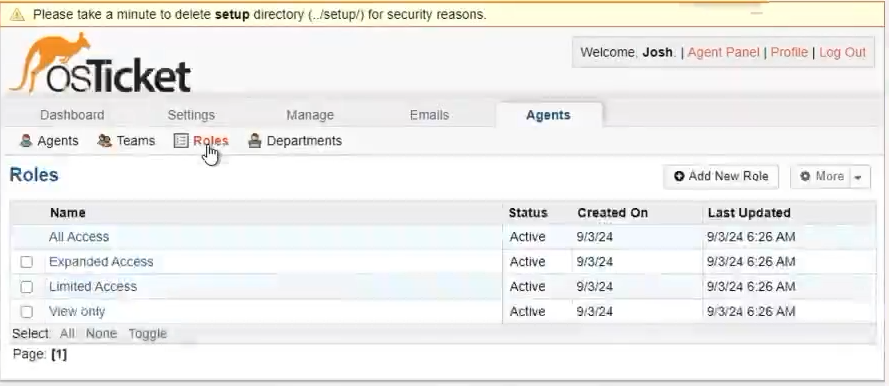
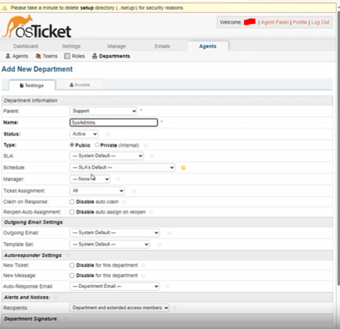
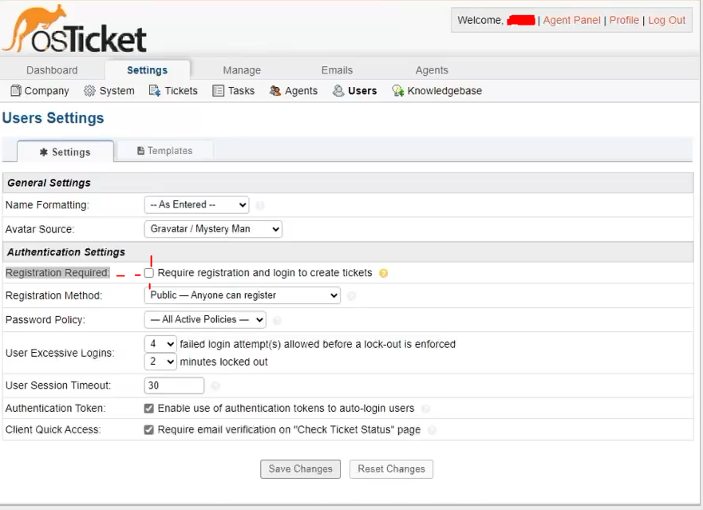
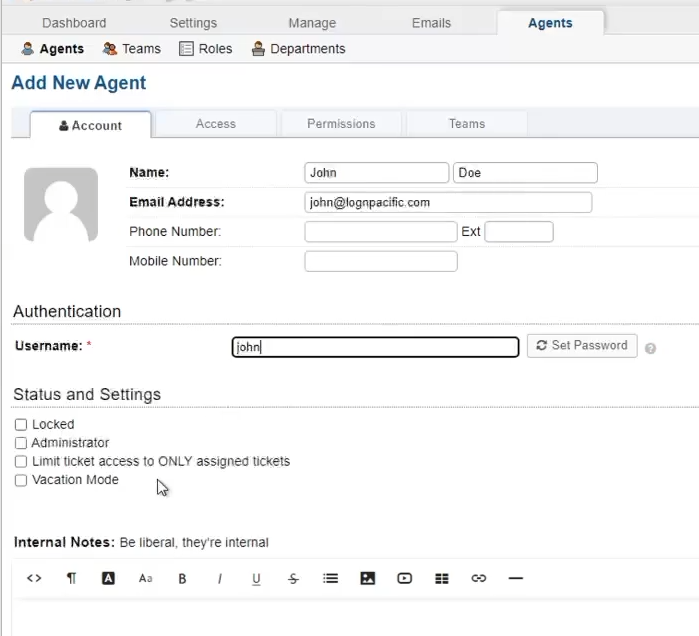
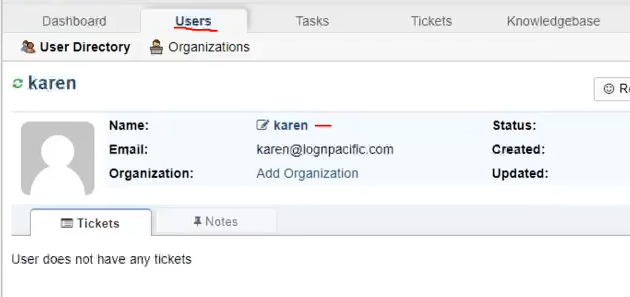

# post-install-config

<h1>osTicket - Post-Install Configuration</h1>
This tutorial outlines the post-install configuration of the open-source help desk ticketing system osTicket. 

<h2>Environments and Technologies Used</h2>

- Microsoft Azure (Virtual Machines/Compute)
- Remote Desktop
- Internet Information Services (IIS)

<h2>Operating Systems Used </h2>

- Windows 11 pro</b> 

<h2>Configuration Steps</h2>

  Configure Roles for grouping permissions

This is where we can add more roles inside a company/department with certain grouping permissions, from as little to view only to all access.
  Next we can configure deparments inside to help with ticket visibility (Help Desk vs SysAdmins, vs Networking)
  
  We can also configure Teams which would be essentially creating a group amongst different departments (or pulling a group from different departments into one team)

 

Next we want to configure it so anyone can create a ticket ( you can configure it to require registration inside the system)

Inside the Agents Tab we can create new agents (since we currently have no "real agents" in order to test out OS ticket creation and delegation/completion).
  Then we can also add in Users to create fake tickets to assign to our fake agents in order to test out ticket eval and distribution.
    
Agents

  
 
Users

  

 

Lorem ipsum dolor sit amet, consectetur adipiscing elit, sed do eiusmod tempor incididunt ut labore et dolore magna aliqua. Ut enim ad minim veniam, quis nostrud exercitation ullamco laboris nisi ut aliquip ex ea commodo consequat. Duis aute irure dolor in reprehenderit in voluptate velit esse cillum dolore eu fugiat nulla pariatur.

 
